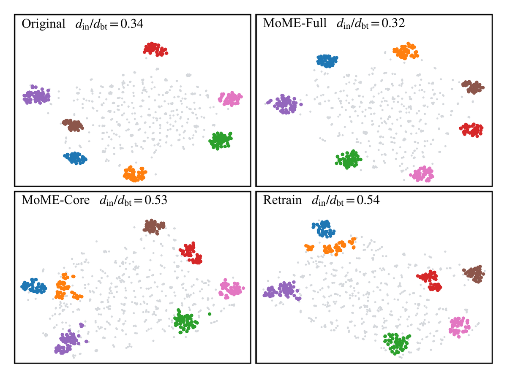
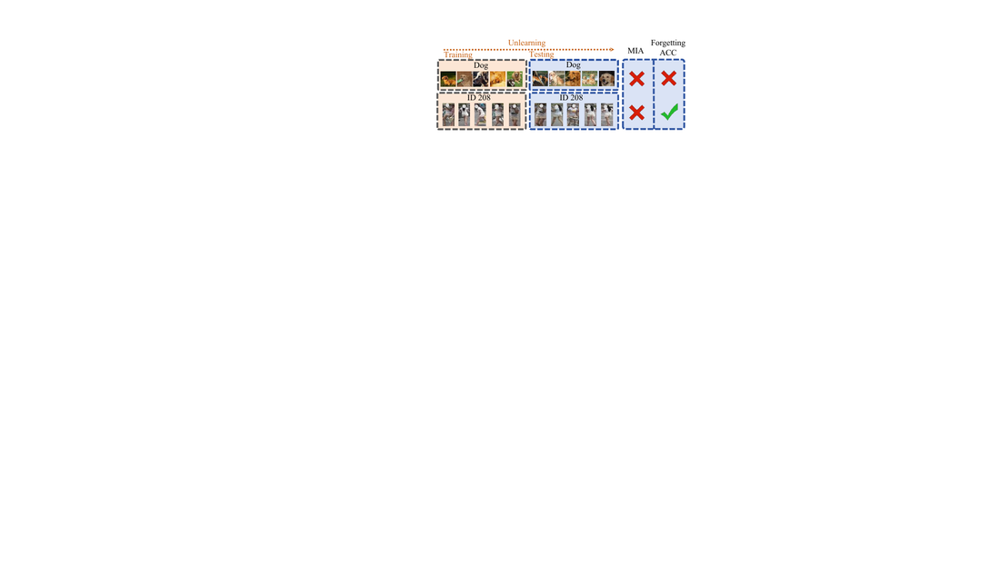
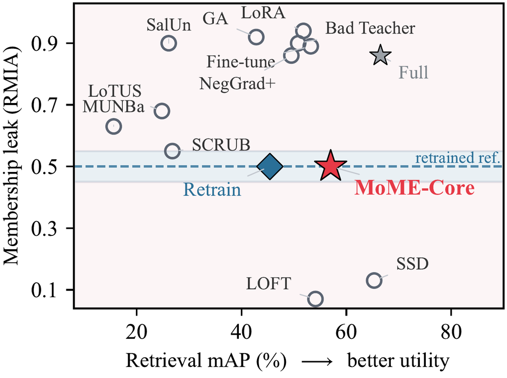

<div align="center">

# MoME: Forget the Data, Keep the Capability
### Switchable Unlearning for Retrieval

**Jingong Chen**<sup>1,2</sup> · **Kyle Gao**<sup>2</sup> · **Guangyuan Li**<sup>2</sup> · **Chulwoo Pack**<sup>1</sup> · **Sijia Liu**<sup>3</sup> · **Kwanghee Won**<sup>1*</sup>

<sup>1</sup>South Dakota State University &nbsp; <sup>2</sup>Aalto University &nbsp; <sup>3</sup>Michigan State University<br>
<sup>*</sup>Corresponding author

<a href="https://huggingface.co/Jingong/MoME"></a> <a href="LICENSE"></a> <a href="https://www.python.org/"></a> <a href="https://pytorch.org/"></a>



</div>

**MoME** splits one re-identification backbone into **core parameters** that preserve retrieval and
zero-initialized **parasitic parameters** that carry the full-data knowledge, and trains them under
**gradient isolation** so the core never receives a forget-set gradient. Disabling the branch
yields **Core**, which satisfies a request to delete a person's training data. Enabling it yields
**Full**, which retains what the deleted data taught. Honoring a request is a flag flip rather
than a retraining run. The figure above shows it: with the branch on the deleted identities sit
where the original model put them, and with it off they sit where a model that never saw them
puts them, from one set of weights.

## News

- **2026-11** · Code, configurations and the reproduction recipes are released.

## Contents

[Why retrieval is different](#why-retrieval-is-different) · [Installation](#installation) ·
[Quick start](#quick-start) · [How to read the tables](#how-to-read-the-tables) ·
[Results](#results) · [Forgetting-Rank](#forgetting-rank) ·
[Reproducing the paper](#reproducing-the-paper) · [Citation](#citation)

## Why retrieval is different

<p align="center"></p>

In classification, deleting a class and losing the ability to predict it are the same event, so
accuracy on the forgotten data is the forgetting signal. In retrieval they come apart. A model
**retrained without a person still ranks another image of them first in 90.3% of Market-1501
queries**, because re-identification is evaluated on identities the model never saw and what the
deleted person contributed is embedding geometry the model has to keep using. Performance on the
deleted data therefore says nothing about whether the deletion happened, and an unlearning method
for retrieval has to be measured against a retrained reference rather than against zero.

<p align="center"></p>

Existing methods remove influence after training. They either keep a strong membership signal, or
drive it past the reference rather than to it, or reach the reference by collapsing retrieval.
MoME keeps the forget-set gradient out of the core during training instead, so the independence is
a property of the schedule rather than an approximation made afterwards.

## Installation

```bash
git clone https://github.com/Jingong-Chen/MoME.git
cd MoME
conda create -n mome python=3.11 -y && conda activate mome
pip install torch torchvision --index-url https://download.pytorch.org/whl/cu128   # pick your CUDA
pip install -r requirements.txt
```

Tested with PyTorch 2.10 (CUDA 12.8) on a single RTX 5090. See [docs/DATA.md](docs/DATA.md) for the
datasets and the ImageNet initialization, neither of which is redistributed here.

## Quick start

One checkpoint, two models. The flag is the whole interface:

```python
from utils.parasitic_utils import set_parasitic_mode

set_parasitic_mode(model, False)   # Core: the deletion request is honored
set_parasitic_mode(model, True)    # Full: the full-data model is back
```

Read both from a trained checkpoint:

```bash
python eval_partition.py --config_file configs/Market/vit_transreid_stride_mome_v3.yml \
  --weight logs/<run>/mome_v3_epoch_120.pth --mode core     # or: --mode full
```

Train a core on Market-1501, with a deletion request that removes half the identities:

```bash
python train_mome_v3.py --config_file configs/Market/vit_transreid_stride_mome_v3.yml \
  MODEL.DEVICE_ID "'0'" \
  MOME.FORGET_MODE "'sub_id'" MOME.FORGET_ID_FRAC 0.5 MOME.SPLIT_SEED 42 MOME.DR_K 4 \
  OUTPUT_DIR logs/market_core
```

[docs/REPRODUCE.md](docs/REPRODUCE.md) gives the full recipe, including the distillation teachers
and the reference families the attacks are scored against.

## How to read the tables

**The target is the `Retrain` row, not the top of the column.** A method is credible when it lands
*on* the reference, and a privacy column far *below* the reference is as distinguishable as one far
above: SSD at 0.22 and LOFT at 0.18 on Market-1501 are not more private than a retrained model, they
are differently identifiable. Utility is read as mAP and Rank-1 on the test split. *U* mAP is
retrieval on the deleted identities, and it is **not** a forgetting signal: the reference itself
scores 77.3 there.

Every attack is the ROC-AUC of a membership test on the deleted identities, scored against a family
of retrained references that shares no checkpoint with the training. Spreads are over five deletion
splits.

## Models

Weights are on [🤗 Jingong/MoME](https://huggingface.co/Jingong/MoME). Each MoME file is one
checkpoint read two ways; `--mode core` honors the deletion request and `--mode full` restores the
full-data model.

| Benchmark | Model | File | mAP | R-1 |
|:---|:---|:---|:---:|:---:|
| Market-1501 | MoME, Core mode | `market/mome_core.pth` | 74.3 | 88.2 |
| Market-1501 | MoME, consolidated payload | `market/mome_full.pth` | 88.7 | 95.2 |
| Market-1501 | Retrain reference | `market/retrain_s42.pth` | 70.5 | 86.9 |
| Market-1501 | Original | `market/original.pth` | 88.0 | 94.8 |
| VeRi-776 | MoME, Core mode | `veri/mome_core.pth` | 42.8 | 69.6 |

These are single checkpoints on deletion split 42, so each reads its own number rather than the
five-split mean the tables report. Reading `mome_core.pth` with `--mode full` gives the co-trained
branch; the consolidated payload is the separate file, and the two are what the main tables and
the ablation report respectively.

All are ViT-B/16 at 256 × 128, deletion split seed 42, `MOME.FORGET_ID_FRAC 0.5`, `MOME.DR_K 4`.
The Retrain reference is released alongside so the comparison the tables make can be reproduced
without retraining a family first. RegDB is a ten-trial protocol with a checkpoint per trial, so
no single file stands for it; [docs/REPRODUCE.md](docs/REPRODUCE.md) gives the recipe.

## Results

#### Market-1501

| Method | R-1 &uarr; | mAP &uarr; | *U* mAP | MIA<sub>ent</sub> | RMIA | U-LiRA |
|:---|:---:|:---:|:---:|:---:|:---:|:---:|
| Original | 94.8&pm;0.0 | 88.0&pm;0.0 | 99.9&pm;0.0 | 1.00&pm;.00 | 0.99&pm;.00 | 0.98&pm;.00 |
| Fine-tune | 94.5&pm;0.2 | 86.9&pm;0.2 | 99.7&pm;0.1 | 0.98&pm;.00 | 0.98&pm;.00 | 0.97&pm;.00 |
| GA | 93.8&pm;0.9 | 85.2&pm;1.6 | 99.3&pm;0.6 | 0.91&pm;.20 | 0.90&pm;.19 | 0.88&pm;.20 |
| NegGrad+ | 94.3&pm;0.1 | 86.3&pm;0.2 | 99.7&pm;0.1 | 1.00&pm;.00 | 0.99&pm;.00 | 0.97&pm;.00 |
| SalUn | 92.8&pm;0.3 | 83.0&pm;0.5 | 99.0&pm;0.3 | 0.80&pm;.03 | 0.89&pm;.01 | 0.88&pm;.01 |
| Bad Teacher | 92.3&pm;0.3 | 81.7&pm;1.0 | 98.8&pm;0.4 | 0.74&pm;.03 | 0.88&pm;.01 | 0.86&pm;.01 |
| LoRA | 94.4&pm;0.1 | 87.0&pm;0.3 | 99.8&pm;0.1 | 1.00&pm;.00 | 0.99&pm;.00 | 0.98&pm;.00 |
| SSD | 92.9&pm;0.1 | 83.2&pm;0.2 | 99.4&pm;0.2 | 0.22&pm;.01 | 0.28&pm;.01 | 0.31&pm;.01 |
| SCRUB | 94.1&pm;0.0 | 85.4&pm;0.0 | 99.7&pm;0.1 | 1.00&pm;.00 | 0.99&pm;.00 | 0.97&pm;.00 |
| LoTUS | 92.6&pm;0.2 | 81.1&pm;0.3 | 98.3&pm;0.2 | 0.56&pm;.03 | 0.80&pm;.02 | 0.75&pm;.01 |
| MUNBa | 93.8&pm;0.1 | 84.7&pm;0.1 | 99.6&pm;0.1 | 0.97&pm;.00 | 0.98&pm;.00 | 0.97&pm;.00 |
| LOFT | 94.3&pm;0.2 | 85.7&pm;0.2 | 99.6&pm;0.1 | 0.18&pm;.01 | 0.33&pm;.01 | 0.40&pm;.01 |
| **Retrain** | 86.7&pm;0.7 | 71.4&pm;0.9 | 77.3&pm;1.5 | 0.48&pm;.01 | 0.50&pm;.01 | 0.50&pm;.01 |
| Core-only | 88.9&pm;0.4 | 75.2&pm;0.7 | 80.5&pm;1.1 | 0.49&pm;.01 | 0.51&pm;.01 | 0.51&pm;.01 |
| **MoME-Core** | 89.0&pm;0.5 | 75.3&pm;0.7 | 80.5&pm;1.1 | 0.49&pm;.01 | 0.51&pm;.01 | 0.52&pm;.01 |
| **MoME-Full** | 95.2&pm;0.1 | 88.8&pm;0.1 | 99.8&pm;0.1 | 1.00&pm;.00 | 0.94&pm;.00 | 0.85&pm;.00 |

#### VeRi-776

| Method | R-1 &uarr; | mAP &uarr; | *U* mAP | MIA<sub>ent</sub> | RMIA | U-LiRA |
|:---|:---:|:---:|:---:|:---:|:---:|:---:|
| Original | 97.1&pm;0.0 | 82.3&pm;0.0 | 100.0&pm;0.0 | 1.00&pm;.00 | 0.89&pm;.01 | 0.81&pm;.02 |
| Fine-tune | 91.8&pm;0.7 | 68.1&pm;1.3 | 94.8&pm;1.2 | 0.91&pm;.02 | 0.88&pm;.03 | 0.87&pm;.03 |
| GA | 39.9&pm;29.7 | 23.1&pm;18.8 | 25.8&pm;22.0 | 0.54&pm;.08 | 0.55&pm;.06 | 0.54&pm;.05 |
| NegGrad+ | 34.0&pm;7.5 | 18.0&pm;3.4 | 13.6&pm;3.0 | 0.51&pm;.04 | 0.51&pm;.03 | 0.51&pm;.03 |
| SalUn | 70.5&pm;1.7 | 42.9&pm;1.7 | 53.3&pm;2.9 | 0.60&pm;.02 | 0.60&pm;.02 | 0.60&pm;.02 |
| Bad Teacher | 77.3&pm;2.5 | 50.2&pm;2.1 | 62.2&pm;2.8 | 0.52&pm;.04 | 0.51&pm;.03 | 0.51&pm;.02 |
| LoRA | 39.9&pm;33.0 | 24.4&pm;19.9 | 25.5&pm;23.8 | 0.55&pm;.12 | 0.55&pm;.09 | 0.55&pm;.08 |
| SSD | 8.6&pm;2.0 | 3.5&pm;0.2 | 2.6&pm;0.4 | 0.51&pm;.02 | 0.48&pm;.01 | 0.49&pm;.01 |
| SCRUB | 2.6&pm;0.9 | 1.5&pm;0.7 | 1.1&pm;0.5 | 0.50&pm;.00 | 0.49&pm;.01 | 0.50&pm;.01 |
| LoTUS | 10.3&pm;0.6 | 3.8&pm;0.1 | 3.0&pm;0.1 | 0.52&pm;.01 | 0.48&pm;.01 | 0.48&pm;.01 |
| MUNBa | 44.8&pm;2.0 | 24.7&pm;1.1 | 23.6&pm;1.0 | 0.49&pm;.02 | 0.49&pm;.01 | 0.49&pm;.01 |
| LOFT | 83.4&pm;0.9 | 41.6&pm;2.8 | 91.0&pm;2.4 | 0.32&pm;.05 | 0.47&pm;.01 | 0.48&pm;.01 |
| **Retrain** | 65.0&pm;6.0 | 37.3&pm;4.0 | 32.8&pm;4.7 | 0.52&pm;.02 | 0.50&pm;.02 | 0.50&pm;.01 |
| Core-only | 69.5&pm;1.0 | 42.4&pm;0.5 | 38.1&pm;1.4 | 0.52&pm;.01 | 0.50&pm;.02 | 0.50&pm;.02 |
| **MoME-Core** | 70.0&pm;0.9 | 42.5&pm;0.4 | 38.3&pm;1.5 | 0.52&pm;.01 | 0.50&pm;.03 | 0.49&pm;.02 |
| **MoME-Full** | 97.2&pm;0.2 | 81.4&pm;0.1 | 100.0&pm;0.0 | 1.00&pm;.00 | 0.87&pm;.01 | 0.78&pm;.02 |

#### RegDB, cross-modality

| Method | V&rarr;T R-1 | V&rarr;T mAP | T&rarr;V R-1 | T&rarr;V mAP | *U* mAP | MIA<sub>ent</sub> | RMIA | U-LiRA |
|:---|:---:|:---:|:---:|:---:|:---:|:---:|:---:|:---:|
| Original | 67.1&pm;0.0 | 64.7&pm;0.0 | 68.3&pm;0.0 | 64.6&pm;0.0 | 100.0&pm;0.0 | 1.00&pm;.00 | 0.86&pm;.01 | 0.79&pm;.01 |
| Fine-tune | 54.9&pm;2.2 | 53.2&pm;1.4 | 52.1&pm;2.7 | 51.3&pm;1.9 | 100.0&pm;0.0 | 0.91&pm;.01 | 0.89&pm;.02 | 0.87&pm;.02 |
| GA | 43.3&pm;3.7 | 42.8&pm;3.0 | 43.1&pm;4.0 | 42.4&pm;3.2 | 99.9&pm;0.2 | 1.00&pm;.00 | 0.92&pm;.02 | 0.88&pm;.03 |
| NegGrad+ | 51.1&pm;4.4 | 49.5&pm;4.1 | 50.7&pm;4.1 | 50.4&pm;4.3 | 99.9&pm;0.2 | 1.00&pm;.00 | 0.86&pm;.01 | 0.81&pm;.01 |
| SalUn | 26.4&pm;1.1 | 26.1&pm;1.5 | 27.0&pm;1.5 | 27.4&pm;1.5 | 97.3&pm;0.9 | 0.93&pm;.01 | 0.90&pm;.01 | 0.87&pm;.01 |
| Bad Teacher | 53.1&pm;2.6 | 50.8&pm;2.5 | 54.5&pm;3.7 | 51.3&pm;3.0 | 100.0&pm;0.1 | 0.93&pm;.03 | 0.90&pm;.01 | 0.85&pm;.01 |
| LoRA | 53.3&pm;8.7 | 51.8&pm;8.0 | 53.1&pm;9.3 | 50.9&pm;8.4 | 100.0&pm;0.0 | 1.00&pm;.00 | 0.94&pm;.06 | 0.91&pm;.07 |
| SSD | 67.4&pm;0.5 | 65.3&pm;0.4 | 68.5&pm;1.0 | 64.9&pm;0.5 | 100.0&pm;0.0 | 0.06&pm;.01 | 0.13&pm;.02 | 0.15&pm;.02 |
| SCRUB | 27.7&pm;30.1 | 26.8&pm;27.6 | 28.7&pm;31.3 | 28.0&pm;29.1 | 55.5&pm;48.3 | 0.55&pm;.08 | 0.55&pm;.07 | 0.53&pm;.05 |
| LoTUS | 25.5&pm;5.3 | 24.8&pm;5.3 | 24.8&pm;7.2 | 24.1&pm;5.5 | 71.8&pm;10.7 | 0.66&pm;.04 | 0.68&pm;.05 | 0.64&pm;.04 |
| MUNBa | 16.4&pm;1.7 | 15.6&pm;1.5 | 16.3&pm;1.4 | 15.2&pm;1.2 | 59.2&pm;7.5 | 0.57&pm;.05 | 0.63&pm;.04 | 0.63&pm;.03 |
| LOFT | 56.1&pm;1.6 | 54.1&pm;1.4 | 57.2&pm;1.6 | 54.6&pm;1.3 | 100.0&pm;0.0 | 0.03&pm;.01 | 0.07&pm;.01 | 0.10&pm;.01 |
| **Retrain** | 47.0&pm;3.8 | 45.4&pm;3.7 | 47.8&pm;4.1 | 45.3&pm;4.0 | 51.8&pm;3.6 | 0.49&pm;.02 | 0.50&pm;.01 | 0.50&pm;.02 |
| Core-only | 60.0&pm;2.9 | 57.7&pm;2.3 | 58.4&pm;4.3 | 55.8&pm;3.2 | 63.5&pm;1.7 | 0.50&pm;.02 | 0.50&pm;.03 | 0.50&pm;.02 |
| **MoME-Core** | 59.0&pm;3.4 | 57.0&pm;2.5 | 58.0&pm;3.8 | 55.4&pm;2.8 | 63.1&pm;1.9 | 0.50&pm;.01 | 0.50&pm;.02 | 0.51&pm;.01 |
| **MoME-Full** | 68.1&pm;0.3 | 66.5&pm;0.1 | 70.4&pm;0.6 | 66.5&pm;0.4 | 100.0&pm;0.0 | 1.00&pm;.00 | 0.86&pm;.01 | 0.79&pm;.01 |

Across the three benchmarks, five deletion splits and three attacks, the difference between Core
and the reference averages **+0.006** and never exceeds **0.032**. Core retrieves above the
reference everywhere: **+3.90 &pm; 0.48** mAP on the Market-1501 test split and **+10.34 &pm; 2.05**
on the RegDB deleted identities. `MoME-Full` is the same weights with the branch enabled.

### Generality

The mechanism needs only affine LayerNorm or BatchNorm parameters, so it transfers.

| Backbone | Pretraining | Task | Core utility | Reference | &rho;<sub>*U*</sub> Core | Reference |
|:---|:---|:---|:---:|:---:|:---:|:---:|
| ViT-B/16 | ImageNet | ReID, Market-1501 | 74.2 | 70.5 | 0.500 &pm; .023 | 0.500 &pm; .085 |
| ResNet-50 AGW | ImageNet | ReID, Market-1501 | 47.5 | 33.3 | 0.500 &pm; .254 | 0.500 &pm; .241 |
| CLIP ViT-B/16 | contrastive | ReID, Market-1501 | 77.7 | 67.6 | 0.500 &pm; .128 | 0.500 &pm; .232 |
| ResNet-18 | scratch | CIFAR-10 class deletion | 47.8 | 47.8 | 0.502 &pm; .056 | 0.501 &pm; .050 |

On the two non-ViT backbones the reference band is too wide to resolve anything, so what transfers
there is the retrieval advantage and the mechanism running, not a privacy result. A BatchNorm
backbone needs its running statistics frozen in Step 2, and `MOME.FREEZE_BN_STEP2` does that.

## Forgetting-Rank

Attack AUC asks whether samples are distinguishable. &rho;<sub>*U*</sub> asks a different question:
whether a model behaves like one retrained under the requested deletion. It ranks the target's loss
on the deleted samples against a family of retrained shadows, so under the null it is
<sup>1</sup>&frasl;<sub>2</sub> by construction and what carries information is its spread.

```bash
python scripts/compute_rho.py --target logs/<run>/mome_v3_epoch_120.pth \
  --family logs/ref_s42,logs/ref_s123,logs/ref_s456,logs/ref_s789,logs/ref_s1024
```

It stays sensitive where the calibrated attacks stop resolving: with the audit restricted to five
of 376 deleted identities the rank reading still separates a leaking model from the null, where
RMIA and U-LiRA no longer resolve a 0.3 signal.

## Reproducing the paper

[docs/REPRODUCE.md](docs/REPRODUCE.md) traces every table to a command. The short version:

```bash
export MOME_DATA=/path/to/data
for S in 42 123 456 789 1024; do bash scripts/repro/market_split.sh $S; done
python scripts/aggregate_splits.py
```

One split is ten retrains and one core, because the reference is a family and the attacks are
scored against a second family disjoint from the teachers. Budget accordingly.

## Repository layout

```
train_mome_v3.py          the method: two steps, gradient isolation
train_retrain_baseline.py the reference, retrained on the retain set
train_*.py, unlearn_ssd.py eleven post-hoc baselines, one file each
eval_partition.py         retrieval on the test split and on the deleted identities
eval_advanced_mia.py      entropy-MIA, RMIA and U-LiRA against a reference family
scripts/compute_rho.py    Forgetting-Rank
utils/parasitic_utils.py  the parasitic parameters and the Core/Full switch
processor/processor_mome_v3.py  the two-step loop
configs/                  Market-1501, VeRi-776 and RegDB
docs/                     data, reproduction
```

## Citation

```bibtex
@article{chen2026mome,
  title   = {Forget the Data, Keep the Capability: Switchable Unlearning for Retrieval},
  author  = {Chen, Jingong and Gao, Kyle and Li, Guangyuan and Pack, Chulwoo and
             Liu, Sijia and Won, Kwanghee},
  year    = {2026}
}
```

## Acknowledgments

This code is built on [TransReID](https://github.com/heshuting555/TransReID), whose backbone,
data pipeline and training loop it extends, and on [timm](https://github.com/huggingface/pytorch-image-models).
We evaluate on [Market-1501](https://zheng-lab.cecs.anu.edu.au/Project/project_reid.html),
[VeRi-776](https://vehiclereid.github.io/VeRi/) and RegDB, the last under the cross-modality
protocol of [DDAG](https://github.com/mangye16/DDAG). The baselines are reimplemented against this
codebase from the descriptions and the released code of
[SalUn](https://github.com/OPTML-Group/Unlearn-Saliency),
[SCRUB](https://github.com/meghdadk/SCRUB),
[SSD](https://github.com/if-loops/selective-synaptic-dampening),
[Bad Teacher](https://github.com/vikram2000b/bad-teaching-unlearning),
LoTUS, MUNBa and LOFT; we thank their authors for releasing their work.

## License

Released under the [MIT License](LICENSE). The upstream TransReID code this builds on is MIT as
well. Datasets and the ImageNet initialization keep the terms of their own releases; see
[THIRD_PARTY_NOTICES.md](THIRD_PARTY_NOTICES.md).
